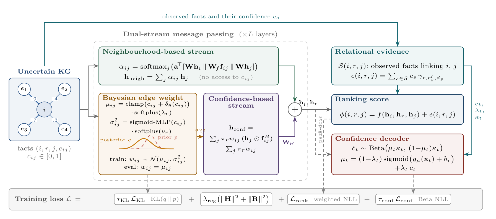

# DS-GAT



DS-GAT is a dual-stream graph attention network for link prediction in uncertain knowledge graphs (UKGs). Each layer has two streams:

- a **neighbourhood-based stream**, an edge-featured attention that does not see confidence;
- a **confidence-based stream**, which aggregates neighbours weighted by a Bayesian estimate of each edge's reliability.

A **relational evidence** term adds the confidence-weighted support of the other training facts that link the same two entities. A **Beta decoder** predicts the confidence of each candidate fact.

The model is evaluated on **CN15K**, **NL27K** and **PPI5K** against two groups of baselines:

- **GAT baselines** (GATv2, EGAT, WSGAT), implemented in this repository;
- **UKG baselines** (UKGE, UPGAT, PASSLEAF, BEUrRE, ssCDL), run with the [unKR](https://github.com/CodeSlogan/unKR) library through the wrappers in `baselinesu/`.

---

## Repository layout

```
models.py                 training / evaluation entry point (DS-GAT and GAT baselines)
utils.py                  data loading, graph construction, filtered MRR/Hits@k
models_base/
  dsgat3.py               DS-GAT (final model): encoder + relational evidence + Beta decoder
  dsgat3_ablation.py      ablations A1, A2, A3 (DSGAT3A1, DSGAT3A2, DSGAT3NE)
  dsgat2.py               dual-stream encoder with Bayesian edge weights (base of DSGAT3)
  dsgat_a1.py, dsgat_a2.py  GAT layers used by the ablations
  gatv2.py, egat.py, wsgat.py  GAT baselines
baselinesu/               unKR wrappers (UKGE, UPGAT, PASSLEAF, BEUrRE, ssCDL, FocusE) + configs
config/                   YAML configs: DS-GAT, ablations, GAT baselines
analysis/                 scripts that rebuild every table and analysis of the paper
data/                     CN15K, NL27K, PPI5K (original splits of UKGE, unchanged)
results/                  every result reported in the paper (see below)
```

---

## Setup

```bash
# 1. PyTorch with CUDA (example: CUDA 11.8)
pip install torch torchvision --index-url https://download.pytorch.org/whl/cu118

# 2. DGL and PyTorch Geometric (versions matching torch and CUDA)
pip install dgl -f https://data.dgl.ai/wheels/cu118/repo.html
pip install torch-geometric

# 3. Remaining dependencies
pip install -r requirements.txt

# 4. Only for the UKG baselines: the unKR library, cloned into unKR/
git clone https://github.com/CodeSlogan/unKR.git unKR
pip install -e unKR/
```

All commands are run from the repository root. Checkpoints, metrics and training curves are written to `output/`.

---

## Running DS-GAT

```bash
python models.py --config config/DSGAT3_cn15k.yaml --seed 42
python models.py --config config/DSGAT3_nl27k.yaml --seed 42
python models.py --config config/DSGAT3_ppi5k.yaml --seed 42
```

Any config value can be overridden on the command line, for example `--gpu 1` or `--seed 2602`.

The paper reports 5 runs with seeds `42 2602 4510 6635 9394`:

```bash
for SEED in 42 2602 4510 6635 9394; do
    python models.py --config config/DSGAT3_cn15k.yaml --seed $SEED
done
```

Main hyperparameters, all set in the configs:

| Paper | Config key / CLI | Value |
|---|---|---|
| embedding dimension | `embedding_dim` | 400 (500 on NL27K) |
| layers | `numhops` | 2 |
| dropout | `dropout` | 0.40 PPI5K, 0.20 CN15K, 0.35 NL27K |
| learning rate α | `lr` | 0.001 |
| KL weight τ_KL | `nll_lambda` | 0.2 |
| confidence-loss weight τ_conf | `beta_lambda` | 0.1 |
| evidence learning rate η_e | `evidence_lr` | 0.05 |
| L2 coefficient λ_reg | `regularization` | 0.01 |
| prior standard deviation σ_0 | env. `DSGAT_PRIOR_SIGMA` | 0.3 |

At evaluation the edge weight is the posterior mean μ_ij (Proposition 1). This is the default (`DSGAT_EVAL_ESTIMATOR=mean`).

### Ablations (Table 3)

```bash
python models.py --config config/ablation/DSGAT3A1_cn15k.yaml   # A1: neighbourhood-based stream only
python models.py --config config/ablation/DSGAT3A2_cn15k.yaml   # A2: confidence stream without Bayesian learning
python models.py --config config/ablation/DSGAT3NE_cn15k.yaml   # A3: without relational evidence
```

### Hyperparameter sensitivity (Table 5)

Each value is changed one at a time around the defaults, with seed 42. `--run-tag` keeps the output files of these runs apart from the main runs:

```bash
python models.py --config config/DSGAT3_nl27k.yaml --evidence-lr 0.01 --run-tag elr0.01        # eta_e
python models.py --config config/DSGAT3_cn15k.yaml --nll-lambda 0.05 --run-tag elr0.05_kl0.05   # tau_KL
DSGAT_PRIOR_SIGMA=0.1 python models.py --config config/DSGAT3_cn15k.yaml --run-tag elr0.05_sig0.1   # sigma_0
```

---

## Running the baselines

### GAT baselines

```bash
python models.py --config config/GAT/EGAT_cn15k.yaml  --seed 42
python models.py --config config/GAT/WSGAT_nl27k.yaml --seed 42
python models.py --config config/GAT/GATV2_ppi5k.yaml --seed 42
```

The reported runs of these baselines use the DistMult score (`score: dismult` in the configs).

### UKG baselines (unKR)

```bash
python baselinesu/UKGEdemo.py     --config baselinesu/config/cn15k/UKGE_cn15k.yaml     --dataset cn15k --seed 42
python baselinesu/UPGATdemo.py    --config baselinesu/config/cn15k/UPGAT_cn15k.yaml    --dataset cn15k --seed 42
python baselinesu/PASSLEAFdemo.py --config baselinesu/config/cn15k/PASSLEAF_cn15k.yaml --dataset cn15k --seed 42
python baselinesu/BEUrREdemo.py   --config baselinesu/config/cn15k/BEUrRE_cn15k.yaml   --dataset cn15k --seed 42
python baselinesu/ssCDLdemo.py    --config baselinesu/config/cn15k/ssCDL_cn15k.yaml    --dataset cn15k --seed 42
```

Replace `cn15k` with `nl27k` or `ppi5k`.

- **UPGAT:** set `UPGAT_MEMFIX=1` to run one full-graph GAT pass per training step instead of three (`baselinesu/upgat_memfix.py`). Model, loss and scoring are unchanged.
- **PASSLEAF:** `PASSLEAFdemocomplex.py` with the `*_c.yaml` configs runs PASSLEAF with the ComplEx score instead of DistMult.
- **Resuming:** the wrappers save full checkpoints, so an interrupted run resumes from `last.ckpt` and accumulates its training time over segments.

---

## Results

`results/` contains the output files of every run reported in the paper. Each `metrics_*.csv` has one `overall` row (MRR, Hits@k, wMRR, MAE, MSE on the test set) followed by one row per relation.

| Folder | Paper |
|---|---|
| `results/link_prediction/<model>/` | Table 1 (link prediction) and Table 2 (confidence MSE), 5 runs per model and dataset |
| `results/ablation/` | Table 3 (seed 42): DS-GAT, A1, A2, A3 |
| `results/sensitivity/` | Table 5 (seed 42): metrics and training curves (validation MRR) |
| `results/timing/<model>/` | Table 6, raw timing files; resumed runs have one file per segment, and the last one holds the cumulative time |
| `results/training_curves/DS-GAT/` | training loss and validation MRR of the DS-GAT runs |
| `results/analysis/` | H1 tests, stream independence, posterior calibration, robustness (`H1_*.txt`, `results_*.json`), evidence coverage and W_B analysis (Table 4, `evidence_coverage.txt`, `evidence_wb_*.json`), significance tests, rebuilt tables |
| `results/figures/` | Fig. 2 (robustness) and Fig. 3 (confidence distributions) |

Rebuild the tables and the significance tests from these files:

```bash
python analysis/make_tables.py          # Tables 1, 2, 3, 5, 6
python analysis/significance_tests.py   # Welch t-test, Holm correction, Cohen's d, bootstrap CI
python analysis/evidence_coverage.py    # Table 4: supports of the test triples, rule-only scorer
```

The analyses below need the trained checkpoints of the 5 DS-GAT runs (and of A2 for the robustness study) in `output/`:

```bash
python analysis/test_assumptions.py --dataset cn15k --layer 0 --checkpoints output/DSGAT3_complex_cn15k_s*t_best_mrr_model.pth   # H1
python analysis/analysis_dsgat3.py --dataset cn15k      # calibration, stream independence, robustness
python analysis/analysis_dsgat3.py --aggregate          # figures and summary over datasets
python analysis/analysis_evidence_wb.py --dataset cn15k # MRR on supported triples, role of W_B
```
